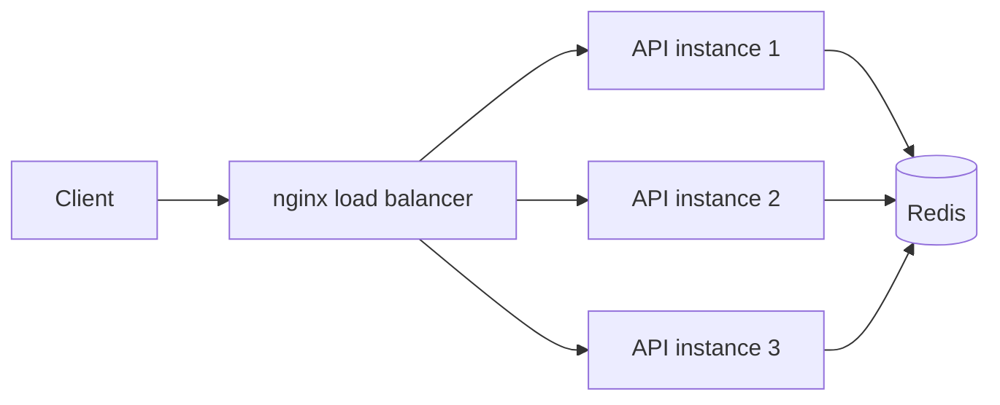

# Distributed Rate Limiter

A distributed rate limiter for HTTP APIs, built with **FastAPI**, **Redis**, and **Docker Compose**. Multiple API instances share one view of each client's usage, so the limit holds no matter which instance handles a request.

## Why this exists

A rate limiter that keeps counters in each server's memory breaks as soon as you run more than one instance: a client limited to 20 requests could send 20 to each of 3 servers and get 60 through. This project solves that by keeping the state in Redis and updating it atomically.

## Architecture



1. A client sends a request with an `x-api-key` header (or falls back to its IP address).
2. nginx forwards it to one of the API instances.
3. Middleware in the instance runs a Lua script in Redis that checks and updates the client's token bucket in a single atomic step.
4. If a token is available, the request goes through. Otherwise the client gets `429 Too Many Requests`.

## Features

- **Token bucket algorithm** (configurable capacity and refill rate)
- **Atomic check-and-update** using a Redis Lua script, so concurrent requests on different instances can't race
- **Redis server clock** used for timing, avoiding clock drift between instances
- **Automatic key expiry**, so idle clients don't fill Redis memory
- **Standard response headers:** `X-RateLimit-Remaining` and `Retry-After`
- **Fail-open behavior:** if Redis is unreachable, requests are allowed through instead of taking the API down
- **Runs as 3 load-balanced instances** with a single command

## Tech stack

Python 3.12 · FastAPI · Redis 7 · Lua · nginx · Docker Compose · pytest · k6

## Getting started

**Prerequisites:** Docker Desktop, Python 3.12

```bash
git clone https://github.com/Aleena05-cell/distributed-rate-limiter.git
cd distributed-rate-limiter
docker compose up --build --scale api=3
```

Try it (on Windows PowerShell use `curl.exe`):

```bash
curl -i http://localhost:8080/ping -H "x-api-key: demo"
```

Normal response:

```
HTTP/1.1 200 OK
x-ratelimit-remaining: 19

{"ok":true}
```

After the limit is exceeded:

```
HTTP/1.1 429 Too Many Requests
retry-after: 1

{"detail":"Too many requests"}
```

## Configuration

Set in `docker-compose.yml`:

| Variable | Default | Meaning |
|---|---|---|
| `CAPACITY` | 20 | Maximum burst size (bucket capacity) |
| `RATE` | 5 | Tokens refilled per second |
| `REDIS_URL` | `redis://redis:6379` | Redis connection string |

## Testing

With the containers running:

```bash
pip install -r requirements.txt
python -m pytest -v
```

The test fires 100 concurrent requests with one API key across all 3 instances and checks that only about 20 get through. Without shared state, roughly 60 would pass (20 per instance).


## Design decisions and tradeoffs

- **Why Redis + Lua?** Redis runs a Lua script atomically, so no two instances can read the same counter and both increment it. This avoids the race condition that breaks naive counters.
- **Why token bucket?** It allows short bursts while enforcing an average rate, and it needs very little memory per client (two values).
- **Fail open vs. fail closed:** when Redis is down, this limiter allows requests through. That favors availability over strict enforcement. A security-sensitive endpoint might choose to fail closed instead.
- **Accuracy vs. latency:** every request makes one network call to Redis. Syncing local counters periodically would be faster but could briefly over-admit requests.

## Project structure

```
├── app/
│   ├── main.py                  # FastAPI app and rate-limit middleware
│   ├── limiter.py               # Redis token bucket wrapper
│   └── scripts/token_bucket.lua # Atomic check-and-update script
├── tests/test_concurrency.py    # Cross-instance concurrency test
├── loadtest/script.js           # k6 load test
├── nginx.conf
├── Dockerfile
└── docker-compose.yml
```

## Roadmap

- [ ] Sliding window algorithm, selectable by environment variable
- [ ] `/health` and Prometheus `/metrics` endpoints
- [ ] GitHub Actions CI
- [ ] Deployment on AWS (ECS, ElastiCache, ALB)